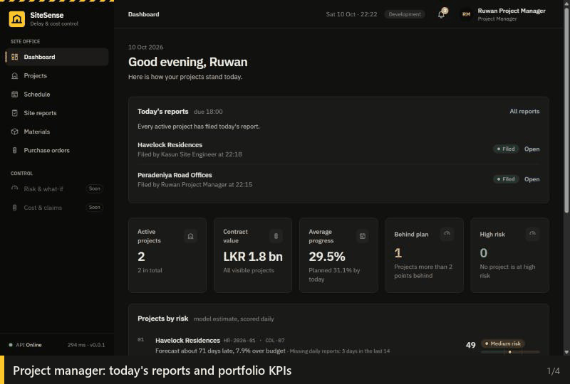
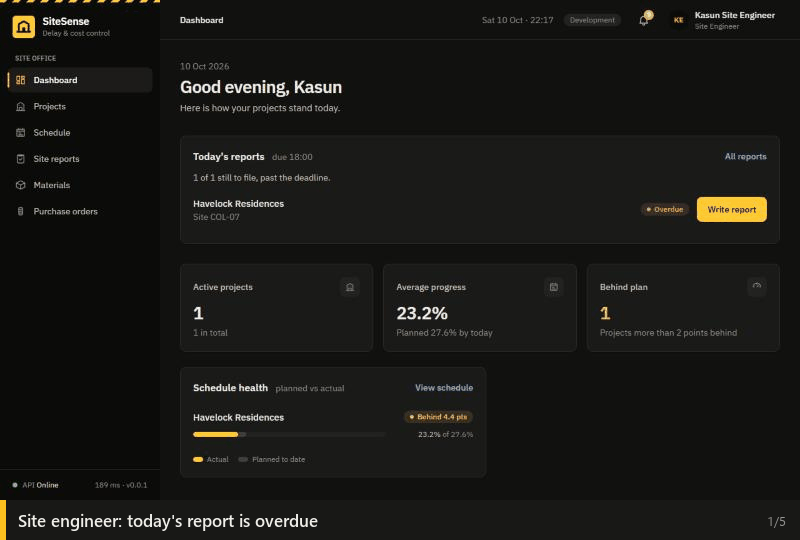
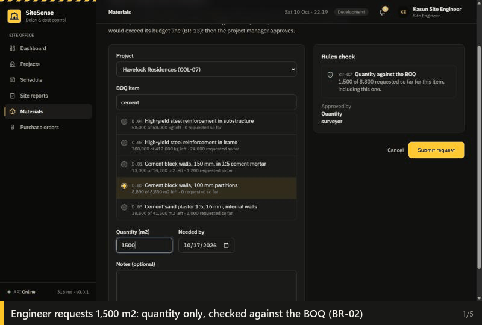

<div align="center">

# SiteSense

**AI-powered delay and cost control for construction projects.**

SiteSense tells a construction company which site will slip before it does, and what to do about it.

[](https://github.com/whoispasindu/SiteSense/actions/workflows/ci.yml)
[](https://github.com/whoispasindu/SiteSense/actions/workflows/codeql.yml)
[](LICENSE)

</div>



> **Status: v0.1 MVP (Phases 0 to 6 of 14).** Projects, BOQ and budgets, schedules, daily site
> reports, materials and approvals, and the first AI feature: a daily delay and cost-overrun risk
> score. More arrives phase by phase (see [Roadmap](#roadmap)). Not production-ready yet. The risk
> model is trained on simulated projects (see the [model card](docs/model-card-risk.md)). The report
> issue classifier (Phase 7) is trained on synthetic sentences and tested on sentences
> written by the project, not real site reports, so its scores are not yet evidence about real sites
> (see its [model card](docs/model-card-report-issues.md)).

## What it will do

Site engineers submit structured daily reports. AI reads them, tags the issues, and forecasts
delay and cost overrun for every project. Managers test recovery plans before committing to
them, and clients see honest progress without internal costs.

- Six roles with their own permissions: Admin, Project Manager, Quantity Surveyor, Site Engineer, Procurement Officer, Client
- Projects, BOQ import and budget lines, with planned against actual progress
- A programme with a critical path, forecast handover and slip, worked out in working days (Poya
  days and public holidays off), plus heavy-rain warnings for concrete pours and stop-work flags
  that hold back the tasks they stop
- Daily site reports with photos and weather filled in automatically
- Materials workflow from request to delivery, driven by 12 business rules
- AI risk forecasts with their likely ranges, SHAP drivers and a what-if recovery planner: a daily
  delay and cost-overrun score for every project, ranked on the dashboard (see the
  [model card](docs/model-card-risk.md))
- Supplier on-time chances, so orders for critical-path items steer away from unreliable suppliers
  (BR-12; [model card](docs/model-card-supplier.md))
- AI report reading that tags issues, always confirmed by a person
- Cost control, progress claims with retention, and variation orders
- A dashboard that says what needs attention today: a daily briefing (AI-written when a Claude API
  key is set, rule-based otherwise, and always labelled), KPIs, cost against plan with the risk
  model's likely range, issue trends, the 5-day weather for each site, alerts and an approval queue
- Alerts by email: urgent ones at once, the rest in an evening digest, and a weekly PDF report for
  project managers and quantity surveyors
- A client portal with honest progress and no internal costs: the handover date the project manager
  publishes (with the reason), milestones, the photos they choose to share, approved claims and the
  retention held, and variation approval. Clients see only the projects they are linked to

## Run it locally

There is no public demo yet; everything below runs on your machine. You need **Docker Desktop**
(or Docker Engine with Compose v2) and **Git**.

**1. Get the code and the local settings**

```bash
git clone https://github.com/whoispasindu/SiteSense.git
cd SiteSense
cp .env.example .env
```

The values in `.env` are for local development only. Change the database passwords there
**before the first start** if you want to (the roles are created once, when the database is first
initialised).

**2. Start the database, API and web app**

```bash
docker compose up --build -d
```

The first build takes a few minutes. The API runs its migrations on start.

**3. Load the demo data**

```bash
docker compose exec backend python -m app.cli seed-dev
```

This creates three sites, one account per role, three demo projects with BOQs, programmes,
daily reports (with confirmed AI issue tags), suppliers, material requests at every stage, and a
risk score for every open project.

**Optional: fetch the larger AI model**

The report issue classifier uses a fine-tuned DistilBERT model (266 MB) that is kept out of the
repository. Without it, the app uses the smaller TF-IDF model that is committed, and says so in the
logs. To fetch it (needs Python 3 and the [GitHub CLI](https://cli.github.com/) signed in to an
account that can read this repository):

```bash
python scripts/fetch_models.py
```

The files are checked against the SHA-256 in the committed manifest before they are used. Restart
the API afterwards (`docker compose restart backend`).

**4. Open the app**

| What | URL |
| --- | --- |
| Web app | http://localhost:5173 |
| API health | http://localhost:8000/api/v1/health |
| API docs (development only) | http://localhost:8000/api/docs |

### Demo accounts

Every account uses the password in `SITESENSE_DEMO_PASSWORD` in your `.env`
(`SiteSense-Demo-2026!` unless you changed it).

**Two-step codes are skipped for these demo accounts.** Company Admins, project managers, quantity
surveyors and procurement officers normally must set up two-step sign-in (a code from an
authenticator app) before they can use SiteSense. Local Docker runs with `SITESENSE_DEMO_MODE=true`,
which skips that requirement for the seeded demo accounts only, so anyone can sign in with the
password above; a banner on every page says it is demo data. Any account you create yourself
still has to set up two-step sign-in if its role needs it. Never turn demo mode on for a real
company's data.

| Role | Email | Try this |
| --- | --- | --- |
| Project Manager | `pm@sitesense.example` | Dashboard ranked by risk: Havelock Residences high, Fort View Apartments medium, Peradeniya Road Offices low; Cost & claims: approve the waiting progress claim; open Havelock Residences: its Risk tab has the forecast with its likely range, the 14-day trend and the what-if planner (tick weather protection: the monsoon is coming), and its Schedule tab for the critical path, forecast slip and rain on pour days; link tasks from a task's edit dialog; approve requests sent to the PM |
| Quantity Surveyor | `qs@sitesense.example` | Enter the quoted price at the QS check and watch BR-01 and BR-13 decide who approves; price variation VO-0003; make a progress claim and see BR-08 calculate it; budget forecast |
| Site Engineer | `engineer@sitesense.example` | File today's daily report for Havelock and write a problem or two: the AI check tags them for you to confirm (a safety issue can flag stop-work on chosen tasks); raise a material request |
| Procurement Officer | `procurement@sitesense.example` | Order approved requests (choose Ceylon Formwork Hire for MR-0003 and BR-12 suggests a more reliable supplier), record deliveries, manage suppliers |
| Company Admin | `admin@sitesense.example` | Users (link client accounts to their projects), sites, holidays, each project's variation limit (BR-09) and the audit log |
| Client | `client@sitesense.example` | The portal for Havelock Residences (the only project linked to this account): progress, the published handover date and why it moved, milestones, shared photos and payments; approve or query VO-0002, a roof plant room with a 10-day time impact (TC-10) |

<p>
  
  
</p>

Stop with `docker compose down`; `docker compose down -v` also deletes the local database.

### More about the demo data

Havelock Residences comes with a full BOQ (`backend/app/seed_data/boq-havelock-residences.csv`,
also a good file to try the import with), a linked programme with its concrete pours marked, a few
weeks of daily reports, five suppliers and material requests at every stage (QS check, PM approval,
ready to order, ordered, delivered, change requested). A finished job, Negombo Road Warehouse, holds
a year of deliveries, so each supplier has an on-time record: one is unreliable and one has too few
deliveries to judge.

Every open demo project is also given a risk score by the model, and the PM and QS dashboards rank
the projects by it, one at each level. Havelock is high: its substructure concrete and steel were
bought at the full BOQ rates after a price rise (about 10% over budget on what is committed), and
it runs short-handed with a few missed reports and late deliveries. Fort View, still in planning,
is medium; Peradeniya is ahead of plan and low. Scores are recalculated every morning and after
each daily report, so they drift as the programme dates come closer.

`docker compose exec backend python -m app.cli reset-demo` puts everything back to the seeded data
(demo mode only); with demo mode on, the API also does this every night at 03:00 site time.

These operator commands run the scheduled jobs on demand:

```bash
docker compose exec backend python -m app.cli send-reminders
```

```bash
docker compose exec backend python -m app.cli refresh-weather
```

```bash
docker compose exec backend python -m app.cli score-risk
```

```bash
docker compose exec backend python -m app.cli check-variance
```

```bash
docker compose exec backend python -m app.cli check-pours
```

Run `refresh-weather` once after seeding to fill in the 14-day forecast (weather in reports, rain
on pour days and the risk model's rain input), then `check-pours` to alert the PM about pours on
heavy-rain days; both also run every morning. For a real company, create the
first admin instead of seeding; it prints a one-time password:

```bash
docker compose exec backend python -m app.cli create-admin --email you@company.lk --name "Your Name"
```

After pulling changes that add dependencies, rebuild and renew the containers' `node_modules`
volume (otherwise the web container keeps its old packages):

```bash
docker compose up --build -V
```


## Running without Docker

Backend (Python 3.13, with a local PostgreSQL that has the roles from
`infra/postgres/init/01-roles.sh`):

```bash
cd backend
python -m venv .venv
.venv/Scripts/activate      # Windows; use `source .venv/bin/activate` on macOS/Linux
pip install -r requirements-dev.txt
cp .env.example .env
alembic upgrade head
uvicorn app.main:app --reload
```

Frontend (Node 22 or later):

```bash
cd frontend
npm ci
npm run dev
```

## Running the tests

```bash
# backend: lint, types, tests
cd backend
ruff check . && ruff format --check . && mypy app tests && pytest --cov

# frontend: lint, types, tests, build
cd frontend
npm run lint && npm run typecheck && npm run coverage && npm run build

# ml: simulator, report-issue data and export tests, and a check that retraining reproduces the risk model
cd ml
ruff check . && pytest && python check_model.py
```

Backend tests use a real PostgreSQL. Start it first with `docker compose up -d db`; the tests
migrate the `sitesense_test` database and run each test in a transaction that is rolled back.
Override the location with `SITESENSE_TEST_DATABASE_URL` and `SITESENSE_TEST_MIGRATION_DATABASE_URL`. Every pull request also runs dependency audits, a secret scan and
CodeQL; see [docs/security.md](docs/security.md).

### Upgrading an existing install

After upgrading to Phase 12, link each client account to its projects (Users → the client), then
clean photos uploaded before this release:

```bash
docker compose exec backend python -m app.cli strip-photo-metadata --dry-run
docker compose exec backend python -m app.cli strip-photo-metadata
```

## Configuration

Backend settings are environment variables prefixed with `SITESENSE_`
(see [backend/.env.example](backend/.env.example)).

| Variable | Purpose | Default |
| --- | --- | --- |
| `SITESENSE_ENVIRONMENT` | `development`, `test` or `production` | `development` |
| `SITESENSE_DATABASE_URL` | Runtime connection (least-privilege role) | local dev URL |
| `SITESENSE_MIGRATION_DATABASE_URL` | Migration connection (schema owner) | falls back to the above |
| `SITESENSE_CORS_ORIGINS` | Comma-separated allowed browser origins | `http://localhost:5173` |
| `SITESENSE_ALLOWED_HOSTS` | Comma-separated accepted `Host` headers | `localhost,127.0.0.1,backend,testserver` |
| `SITESENSE_MAX_REQUEST_BODY_BYTES` | Largest accepted request body | `1048576` |
| `SITESENSE_LOG_LEVEL` | `DEBUG`, `INFO`, `WARNING`, `ERROR` | `INFO` |
| `SITESENSE_JWT_SECRET` | Access-token signing key, 32+ characters | development value (refused in production) |
| `SITESENSE_ACCESS_TOKEN_TTL_MINUTES` | Access-token lifetime | `15` |
| `SITESENSE_REFRESH_TOKEN_TTL_DAYS` | Refresh-token lifetime (rotated on use) | `7` |
| `SITESENSE_SESSION_MAX_DAYS` | Absolute session limit | `30` |
| `SITESENSE_LOGIN_MAX_FAILURES` / `SITESENSE_LOCKOUT_MINUTES` | Account lockout | `5` / `15` |
| `SITESENSE_LOGIN_RATE_PER_MINUTE` | Sign-in attempts per IP per minute | `10` |
| `SITESENSE_WRITE_RATE_PER_MINUTE` | Writes (POST, PUT, PATCH, DELETE) per signed-in user per minute | `120` |
| `SITESENSE_HEAVY_RATE_PER_MINUTE` | What-if runs and weekly PDFs per user per minute | `20` |
| `SITESENSE_MFA_KEY` | Encrypts two-step secrets and keys recovery codes; 32+ characters, not the JWT secret (changing it resets every enrolment) | development value (refused in production) |
| `SITESENSE_DEMO_MODE` | Demo banner, logged emails, and the seeded demo accounts skip two-step codes; never for real data | `false` (`true` in local Docker) |
| `SITESENSE_COOKIE_SECURE` | Secure flag on the refresh cookie | `true` |
| `SITESENSE_MEDIA_ROOT` | Folder for site photos (mount a persistent volume in production) | `var/media` |
| `SITESENSE_MAX_PHOTO_BYTES` / `SITESENSE_MAX_PHOTOS_PER_REPORT` | Photo limits | `10485760` / `12` |
| `SITESENSE_WEATHER_ENABLED` | Live forecast from Open-Meteo (off: cached forecasts only) | `true` |
| `SITESENSE_SCHEDULER_ENABLED` | Run the 18:00 reminder and 05:30 weather jobs in the API process | `true` |
| `SITESENSE_REPORT_DEADLINE_HOUR` | BR-07 daily report deadline, site time | `18` |
| `SITESENSE_ANTHROPIC_API_KEY` | Claude API key for the AI briefing (optional; without it the briefing is rule-based) | unset |
| `SITESENSE_BRIEFING_MODEL` | Claude model that writes the briefing | `claude-haiku-5-5` |
| `SITESENSE_BRIEFING_TIMEOUT_SECONDS` | How long to wait for the model before using the rule-based briefing | `20` |
| `SITESENSE_SMTP_HOST` | Mail server (optional; without it emails are written to the log) | unset |
| `SITESENSE_SMTP_PORT` / `SITESENSE_SMTP_SECURITY` | Port and `starttls`, `ssl` or `none` (refused in production) | `587` / `starttls` |
| `SITESENSE_SMTP_USERNAME` / `SITESENSE_SMTP_PASSWORD` | Mail server sign-in | unset |
| `SITESENSE_EMAIL_FROM` | Sender of alert emails | `SiteSense <no-reply@sitesense.example>` |
| `SITESENSE_APP_BASE_URL` | Where links in emails point (https in production) | `http://localhost:5173` |
| `SITESENSE_DIGEST_HOUR` / `SITESENSE_DIGEST_MINUTE` | Evening digest time, site time | `18` / `30` |

In production the API refuses to start with debug on, wildcard or plain-HTTP origins, the
example database password, a plain-HTTP `SITESENSE_APP_BASE_URL`, a mail server without TLS, the
development or a reused `SITESENSE_MFA_KEY`, or two-step enforcement off.

### Two-step sign-in

Required for Company Admins, project managers, quantity surveyors and procurement officers (they
see costs or run the company); optional for site engineers and clients, under **Two-step sign-in**
in the account menu. Setting up shows a QR code for any authenticator app (Google Authenticator,
Microsoft Authenticator, 2FAS…) and ten single-use recovery codes. Codes are time-based (RFC 6238),
each works once, and wrong codes count towards the same lockout as wrong passwords. The
authenticator secret is stored encrypted, recovery codes only as keyed hashes.

Lost phone: sign in with a recovery code, then ask a Company Admin to reset two-step sign-in
(Users → the person → Reset two-step sign-in). Resets sign the person out everywhere and are
recorded in the audit log. An admin cannot reset their own; they use a recovery code, or another
admin resets it.

### The AI briefing

The dashboard opens with today's briefing: 3 to 5 points on what needs attention, each with the
number of records it rests on. It works with no setup: without a key, everyone gets a rule-based
briefing written from fixed templates. To have Claude write it:

1. Create an API key in the [Claude Console](https://platform.claude.com/) and give it a monthly
   spending limit there.
2. Add it to `backend/.env` (read by both Docker and a local run):

   ```bash
   SITESENSE_ANTHROPIC_API_KEY=sk-ant-...
   # optional, to use another model:
   SITESENSE_BRIEFING_MODEL=claude-haiku-5-5
   ```

3. Restart the backend (`docker compose restart backend`).

Each briefing is labelled **AI-written** or **Rule-based**, so readers always know which they are
seeing. If the model is slow, refuses, runs out of credit or answers outside the expected shape,
the rule-based briefing is shown with a short note. The model receives only structured facts
(scores and their ranges, counts, project codes and names, rule IDs), never report text, comments
or people's names; a test captures the real request and fails if any of those reach it. One
answer is reused while the facts are unchanged, and a new one is asked for at most every 15
minutes per person.

### Email alerts

Every alert appears in the app. By email:

- **At once:** high risk (BR-10), stop-work (BR-11), heavy rain on a pour (BR-06), high-severity
  issues, and anything waiting for your approval. Stop-work emails cannot be turned off.
- **Evening digest** at 18:30 site time for everything else, skipped when there is nothing new.
- **Weekly report (PDF)** on Mondays at 07:00 site time: on by default for project managers,
  opt-in for quantity surveyors. It holds cost figures, so no other role can get it.

Each person chooses under **Email settings** in their account menu. Emails are short: the alert's
title, one fixed sentence and a link into SiteSense; comments, report text and amounts stay in the
app. Without `SITESENSE_SMTP_HOST`, emails are written to the backend log instead of sent, which is
how local development and the demo run.

## Tech stack

| Layer | Technology |
| --- | --- |
| Web | React 19, TypeScript, Vite, Tailwind CSS 4, React Router, TanStack Query, Zod |
| API | Python 3.13, FastAPI, Pydantic, SQLAlchemy 2, Alembic, structlog |
| Data | PostgreSQL 18 |
| AI | LightGBM (risk), scikit-learn (TF-IDF baseline), DistilBERT fine-tuned with PyTorch (report issues); served as JSON (pure Python) and ONNX Runtime, no pickles |
| Quality | pytest, Ruff, mypy, Vitest, Testing Library, ESLint, CodeQL, Gitleaks |

Architecture notes, the [roles and access matrix](docs/roles-and-access.md) and decision records live in [docs/](docs/).

## Project structure

```
backend/        FastAPI app (api, models, schemas, services, ai, integrations, core) + Alembic
frontend/       React + TypeScript web app
ml/             synthetic project simulator, training, notebooks, model metrics (see ml/README.md)
infra/          database bootstrap scripts
docs/           architecture, decision records, security reviews, model cards
.github/        CI, CodeQL, Dependabot, issue and PR templates
```

## Roadmap

| Phase | Name | Status |
| --- | --- | --- |
| 0 | Setup and foundations | Done |
| 1 | Authentication, roles and users | Done |
| 2 | Projects, BOQ and budget | Done |
| 3 | Schedule basics | Done |
| 4 | Daily site reports | Done |
| 5 | Materials, approvals and rules engine | Done |
| 6 | Demo data and risk model v1 → **v0.1 MVP** | Done |
| 7 | Report NLP classifier | Done |
| 8 | Cost control, claims and variations | Done |
| 9 | Advanced schedule | Done |
| 10 | Risk model v2, what-if planner and supplier model | Done |
| 11 | Dashboard, alerts and AI briefing | Done |
| 12 | Client portal | Done |
| 13 | Hardening and deployment | In review |
| 14 | Testing, UAT and evaluation → **v1.0** | Planned |
| Later | Public demo: a hosted instance with seeded data | Planned |

After v1.0: an offline-first mobile app for site engineers, voice input in Sinhala, Tamil
and English, and SMS alerts for stop-work and high risk (alerts already go through one channel
interface, so an SMS sender plugs in without changing the alert rules).

## Contributing

Contributions are welcome. Read [CONTRIBUTING.md](CONTRIBUTING.md) first, and report security
problems privately as described in [SECURITY.md](SECURITY.md).

## Licence

[MIT](LICENSE). Fonts: IBM Plex Sans and IBM Plex Mono (SIL Open Font License), self-hosted through
Fontsource.
